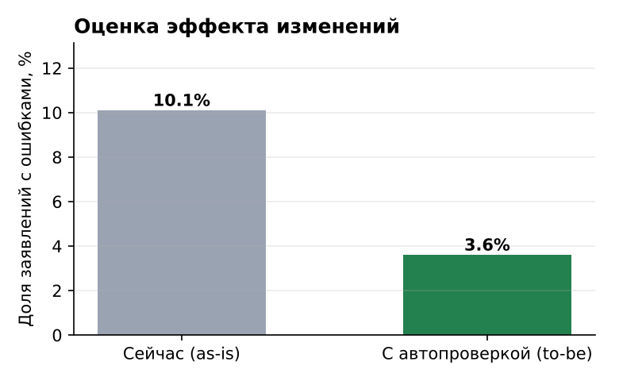
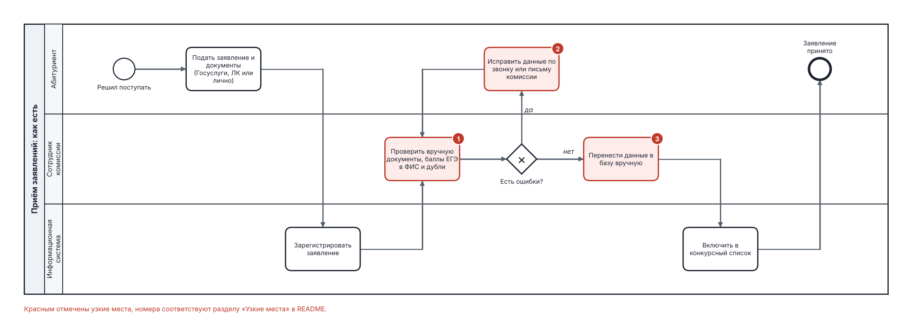
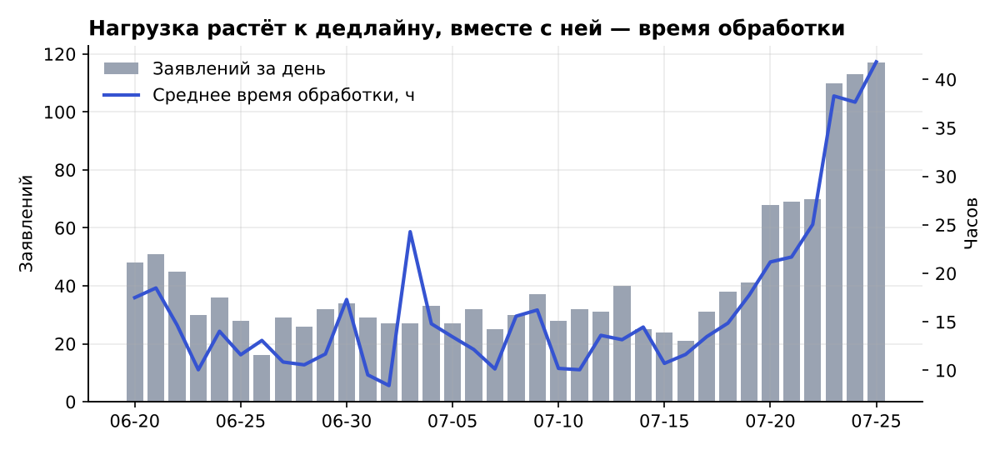
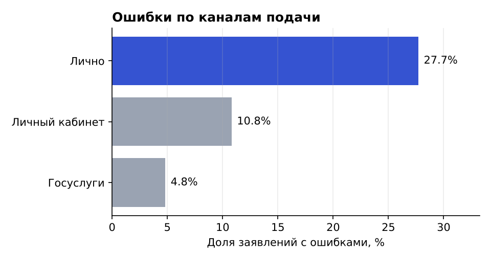
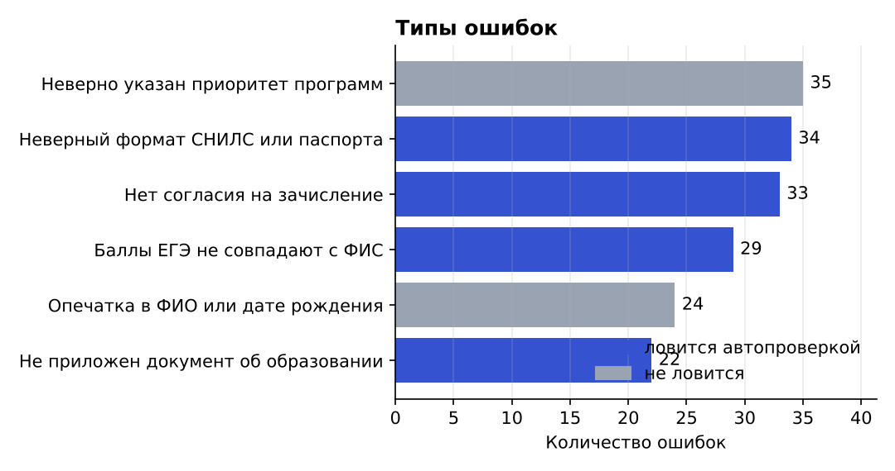
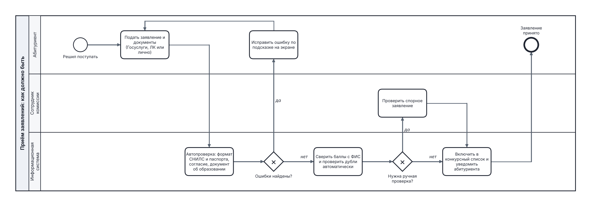

# Анализ процесса приёма заявлений абитуриентов

Учебный проект по бизнес-анализу. Задача — найти, на каких этапах приёма заявлений в вуз возникают ошибки и задержки, и предложить изменения процесса, которые снизят нагрузку на приёмную комиссию и число повторных обращений абитуриентов.

Идея проекта взята из личного опыта: летом 2025 года я работал в приёмной комиссии НИЯУ МИФИ и видел, сколько времени уходит на исправление ошибок в заявлениях.

> Все данные в проекте **синтетические**: их генерирует скрипт `scripts/generate_data.py`. Реальных персональных данных абитуриентов здесь нет. Распределения подобраны так, чтобы отражать типичные проблемы приёмной кампании.

## Коротко о результатах

- **10,1%** заявлений содержат ошибки, при личной подаче — **27,7%**, через Госуслуги — **4,8%**.
- Заявление с ошибкой обрабатывается в среднем **63,5 часа** против **16 часов** без ошибок. Абитуриент ждёт исправления в среднем **42 часа**.
- В последние 5 дней приёма поток заявлений в **2,9 раза** выше обычного, а время обработки растёт с **14,3 до 34,7 часа**.
- **4,5%** заявлений — дубли от тех же абитуриентов.
- **2/3 ошибок** можно поймать автоматической проверкой при подаче. По оценке на учебных данных, доля заявлений с ошибками снизится с **10,1% до 3,6%** (на 64,5%).



## Что сделано

| Этап | Результат | Файлы |
|---|---|---|
| Описание текущего процесса | BPMN-схема «как есть» с тремя дорожками: абитуриент, сотрудник комиссии, система | `bpmn/as_is.bpmn`, `bpmn/as_is.png` |
| Поиск узких мест | 3 узких места на схеме, подтверждённые данными | этот README |
| Анализ данных | 11 SQL-запросов: доля ошибок, время обработки, нагрузка по дням, дубли, оценка эффекта | `sql/analysis.sql`, `results/query_results.md` |
| Визуализация | 4 графика | `results/charts/` |
| Целевой процесс | BPMN-схема «как должно быть» с автопроверкой | `bpmn/to_be.bpmn`, `bpmn/to_be.png` |
| Требования | 10 user stories с критериями приёмки и нефункциональные требования | `docs/requirements.md` |

## 1. Процесс «как есть»



Абитуриент подаёт заявление через Госуслуги, личный кабинет вуза или лично. Система регистрирует заявление, после чего сотрудник комиссии вручную проверяет документы, сверяет баллы ЕГЭ с ФИС и ищет дубли. Если есть ошибка, сотрудник связывается с абитуриентом и ждёт исправления. Затем данные вручную переносятся в базу, и заявление попадает в конкурсный список.

## 2. Узкие места

**① Ручная проверка каждого заявления.** Сотрудник проверяет формат документов, баллы и дубли глазами. В пиковые дни это главная причина задержек: в последние 5 дней приёма обработка занимает в 2,4 раза больше времени (34,7 часа против 14,3).



**② Исправление ошибок через звонки и письма.** Ошибка обнаруживается только после подачи, и абитуриента нужно найти и дождаться. Исправление занимает в среднем 42 часа, а заявление с ошибкой обрабатывается в 4 раза дольше.

**③ Ручной ввод данных.** При личной подаче данные переносятся в систему вручную, поэтому ошибок здесь больше всего: 27,7% заявлений против 4,8% через Госуслуги.



Самые частые типы ошибок:



Четыре типа из шести (формат СНИЛС и паспорта, отсутствие согласия, неприложенный документ об образовании, расхождение баллов с ФИС) можно поймать автоматически ещё в момент подачи.

**Наблюдение об операторах.** Разница в скорости работы операторов (от 18,6 до 23,3 часа в среднем) почти полностью объясняется тем, сколько заявлений с ошибками им досталось: у самого быстрого 12 ошибок, у самого медленного 28 (запрос 8). Проблема в процессе, а не в людях, поэтому решение — автоматизация, а не контроль сотрудников.

## 3. Процесс «как должно быть»



Что меняется:
1. **Автопроверка при подаче.** Система сразу проверяет формат СНИЛС и паспорта, наличие согласия и документа об образовании и показывает подсказку. Абитуриент исправляет ошибку сам, не дожидаясь звонка.
2. **Автоматическая сверка с ФИС и поиск дублей.** Сотрудник подключается только к спорным заявлениям.
3. **Уведомление абитуриента** о том, что заявление принято и включено в конкурсный список.

Ожидаемый эффект, рассчитанный запросом 11: доля заявлений с ошибками снижается с 10,1% до 3,6%. Остаются ошибки, которые система поймать не может: опечатки в ФИО и неверный приоритет программ.

## 4. Требования

User stories с критериями приёмки, нефункциональные требования и метрики успеха — в [docs/requirements.md](docs/requirements.md).

## Как запустить

```bash
pip install matplotlib
python scripts/generate_data.py   # создаёт data/admission.db и CSV
python scripts/run_analysis.py    # выполняет SQL-запросы, пишет results/
python scripts/build_bpmn.py      # строит BPMN-схемы
```

Файлы `.bpmn` открываются в [Camunda Modeler](https://camunda.com/download/modeler/) или на [demo.bpmn.io](https://demo.bpmn.io). Базу можно поднять в любой СУБД из `data/admission_dump.sql`, а CSV-файлы подходят для Yandex DataLens или Power BI.

## Структура данных

| Таблица | Что хранит |
|---|---|
| `applications` | заявления: канал подачи, даты подачи и завершения обработки, статус, оператор, признак дубля |
| `errors` | ошибки в заявлениях: тип, когда найдена, когда исправлена |
| `error_types` | справочник типов ошибок и признак «ловится автопроверкой» |
| `programs` | образовательные программы и число бюджетных мест |
| `operators` | сотрудники приёмной комиссии (8 человек) |

## Инструменты

SQL (SQLite: CTE, оконные функции, LEFT JOIN, подзапросы), Python (sqlite3, matplotlib), BPMN 2.0, user stories.
